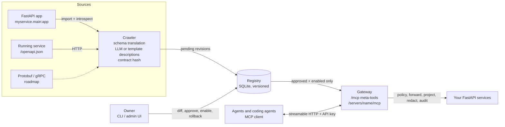

# agentifyapi

[](https://github.com/SomilAgg123/agentifyapi/actions/workflows/ci.yml)
[](https://pypi.org/project/agentifyapi/)
[](https://pypi.org/project/agentifyapi/)
[](LICENSE)

**Make your FastAPI services agent-ready with owner-approved MCP tools.**

## Install

```bash
pip install agentifyapi
```

Python 3.11 or newer. If the release is not on PyPI yet:

```bash
pip install "git+https://github.com/SomilAgg123/agentifyapi"
```

## Example

A tiny FastAPI app. One `mount(app)` call adds a governed `/mcp` endpoint. Routes become MCP tools,
but they stay hidden until you approve them.

```python
# examples/quickstart.py
from fastapi import FastAPI
from agentifyapi import mount
from agentifyapi.config import PolicyConfig

app = FastAPI(title="inventory")


@app.get("/stock/{sku}")
def get_stock(sku: str) -> dict:
    """Units on hand for a SKU."""
    return {"sku": sku, "on_hand": 42, "warehouse": "nyc"}


mount(app, owner="you", database="quickstart.db", policy=PolicyConfig(allow_anonymous=True))  # local demo only
```

```bash
uvicorn examples.quickstart:app --port 8200
# another terminal:
agentifyapi --db quickstart.db tools list
# inventory.get_stock   -   disabled   1
agentifyapi --db quickstart.db tools approve inventory.get_stock --by you
agentifyapi --db quickstart.db tools enable inventory.get_stock
```

An MCP client pointed at `http://127.0.0.1:8200/mcp` then discovers and calls the tool:

```text
>>> list_tools(server="inventory")          # before approve → []
>>> invoke_tool(tool="inventory.get_stock", args={"sku": "KB-1"})
{"sku": "KB-1", "on_hand": 42, "warehouse": "nyc"}
```

Run the whole flow yourself with `python scripts/verify_quickstart.py` (CI runs this on every push).
For many services behind one gateway, see [Standalone gateway demo](#standalone-gateway-demo).

## How this differs from fastapi_mcp and FastMCP

[fastapi_mcp](https://github.com/tadata-org/fastapi_mcp) and [FastMCP](https://github.com/PrefectHQ/fastmcp)
(`FastMCP.from_fastapi` / `from_openapi`) are the quickest ways to expose FastAPI routes as MCP tools.
Use them if you want every selected route live immediately. agentifyapi converts routes too, but its focus
is what happens *around* the tools when many teams' APIs are involved.

| | agentifyapi | fastapi_mcp | FastMCP |
|---|---|---|---|
| Approval | New and changed tools wait in a pending state until an owner approves and enables them. | Selected routes are live on mount. | Selected routes are live on convert. |
| Change control | Each tool has versioned revisions with a reviewable diff and one-command rollback. | — | — |
| Policy | Per-caller and per-role allow-lists by API key, default deny. | FastAPI dependencies and OAuth on the MCP endpoint. | OAuth, JWT, and other auth providers. |
| Data protection | PII redaction (emails, phones, SSNs, Luhn-checked cards) and response projection. | — | — |
| Audit | A JSON-lines record of every call: caller, decision, status, redaction count. | — | Middleware you add. |
| Discovery at scale | Four meta-tools (`discover_servers`, `list_tools`, `get_tool_schema`, `invoke_tool`) instead of one huge tool list. | One flat tool list. | One flat tool list; routes can also be resources. |

A dash means that control is not built in. The other projects have strengths this one doesn't,
such as broader MCP feature coverage and richer authentication. agentifyapi is young (0.x).


> Inspired by Uber's [Designing MCP Gateway](https://www.uber.com/blog/designing-mcp-gateway/), rebuilt as a small
> open-source project for the FastAPI ecosystem. Not affiliated with Uber.

## Why

| Problem | What agentifyapi does |
|---|---|
| Your APIs were built before MCP | Converts FastAPI routes (Pydantic models, docstrings, tags, dependencies) into MCP tools. Falls back to any `/openapi.json`. |
| Auto-generated tools are risky | Every tool starts **disabled**. An owner reviews a diff, approves, and enables it. Spec changes become pending revisions, so the live version never changes silently. Rollback is one command. |
| Thousands of tools flood the context window | Agents use 4 meta-tools (`discover_servers`, `list_tools`, `get_tool_schema`, `invoke_tool`) and ask for only the response `fields` they need. |
| Agents shouldn't see everything | Per-caller and per-role policy via API keys. Regex PII redaction (emails, phones, SSNs, Luhn-valid cards). JSON-lines audit log. |

## Architecture



Two deployment shapes share the same core.

* **Embedded.** `mount(app)` serves one service with in-process dispatch and no extra deployment.
* **Standalone gateway.** `agentifyapi serve` puts many services behind one MCP endpoint and re-crawls them on an interval.

## Standalone gateway demo

```bash
git clone https://github.com/SomilAgg123/agentifyapi && cd agentifyapi
uv sync                          # or: pip install -e ".[dev]"
make demo                        # = python scripts/run_demo.py  (no Docker needed)
```

The demo starts two mock FastAPI services (`orders`, `users`) and crawls them. Orders is crawled
by importing the app, and users over HTTP. It then shows a diff, approves three tools, starts the
gateway on `:8000`, and runs `examples/agent_client.py`, an MCP SDK client that discovers and calls tools.

```text
>>> invoke_tool({"tool": "orders.get_order", "args": {"order_id": 101}, "fields": ["id", "status", "items.sku", "card_number", "shipping_note"]})
{ "id": 101, "status": "shipped", "items": [{"sku": "KB-1"}],
  "card_number": "[REDACTED:card]", "shipping_note": "Call [REDACTED:phone] on arrival" }
```

`python scripts/run_demo.py --keep` leaves it running so you can open the admin UI at
<http://127.0.0.1:8000/admin/>. With Docker, run `make demo-docker`.

`make verify` boots the same demo and checks 8 behaviors against it over real MCP HTTP: discovery,
approval gating, projection, redaction, policy denial, the per-server endpoint, the admin UI, and the audit log.

### Connect a coding agent

Point any MCP client that speaks streamable HTTP at `http://127.0.0.1:8000/mcp` with the header
`x-api-key: demo-support-key` (or `Authorization: Bearer ...`). If you prefer a flat tool list, use
`http://127.0.0.1:8000/servers/orders/mcp`. Each enabled tool appears there directly, with an optional `_fields` argument.

## The approval flow

```
crawl ──► v1 pending ──approve──► v1 live (disabled) ──enable──► served to agents
   spec changes ──► v2 pending (v1 keeps serving) ──approve──► v2 live ──rollback──► v1 live
   endpoint removed upstream ──► hidden + disabled, history kept
```

* Changes are detected with a hash of the tool **contract** (method, path, schemas, docs). The
  generated description is excluded, so LLM wording never creates noise revisions.
* `agentifyapi tools list | diff | approve | reject | enable | disable | rollback | history <tool>`.
  `server.*` works for bulk actions. `--by` records the reviewer.
* The admin UI (`/admin` standalone, `/mcp-admin` embedded) shows the same diff with buttons.
* To exclude a route entirely, use `@app.post(..., openapi_extra={"x-agentifyapi-exclude": True})`.

## FastAPI-native introspection

`--app module:app` (or `app:` in config) imports your app, including app factories, and walks its
`APIRoute`s. On top of `app.openapi()` it recovers these details.

* **Clean tool names** from the route function (`get_order`, not `get_order_orders__order_id__get`).
* **Full docstrings** as tool documentation.
* **The `Depends()` graph** (for example `require_admin`), shown to reviewers in the diff.
* Exact **Pydantic** request and response schemas with `$ref`s inlined. Recursive models are cut safely.

If the import fails (missing dependencies or environment) and a `base_url` is set, it falls back to `/openapi.json`.

## Configuration reference

```yaml
database: registry.db          # SQLite registry
audit_log: audit.log           # JSON lines; "" to disable
crawl_interval_seconds: 300    # 0 = on demand only
redact_pii: true

services:
  - name: orders               # tool names become orders.<route_name>
    owner: team-commerce
    app: services.orders.main:app   # FastAPI-native crawl (optional)
    app_dir: ../orders-repo         # put this repo on sys.path first (optional)
    base_url: http://orders:8000    # where calls are forwarded (+ /openapi.json fallback)
    openapi_url: http://...         # override spec location (optional)
    # proto: path/to/descriptor.pb  # extension point, not implemented in v1

policy:
  allow_anonymous: false       # dev only: callers without a key may use any enabled tool
  api_keys:
    <key>: { name: support-agent, roles: [support] }
  rules:                       # allow-list, default deny
    - tools: ["orders.*"]      # fnmatch on tool names
      roles: [support]
      callers: [some-agent]
```

| Env var | Effect |
|---|---|
| `ANTHROPIC_API_KEY` / `OPENAI_API_KEY` | LLM-written tool descriptions (`AGENTIFYAPI_LLM_MODEL` picks the model) |
| `AGENTIFYAPI_DESCRIBER=template` | Force the deterministic template describer |

`mount(app, name=, owner=, database=, policy=, prefix=, admin_path=, auto_approve=False, redact_pii=True, audit_log=)`.
`auto_approve=True` is for local development only.

## Development

```bash
uv sync && uv run pre-commit install
uv run pytest --cov && uv run pyright
uv run python scripts/verify_quickstart.py   # README example
uv run python scripts/verify_demo.py         # multi-service gateway
```

See [CONTRIBUTING.md](CONTRIBUTING.md), [AGENTS.md](AGENTS.md) for coding agents, and [SECURITY.md](SECURITY.md) to report vulnerabilities.

The tests cover schema translation, FastAPI introspection, the crawler and approval flow (with a
fake spec), the CLI, the admin UI, projection, redaction, and policy. Two end-to-end runs go over
real MCP streamable HTTP: the standalone gateway against a live mock service, and embedded `mount()`.

## Roadmap

- **gRPC / Protobuf** crawling from descriptor sets (`proto:` is a stub today).
- **OAuth passthrough** for third-party APIs and end-user identity propagation.
- **Code-mode CLI** that writes tool output to files so coding agents grep them instead of loading results into context.
- **Semantic discovery index** with embeddings for `discover_servers` and `list_tools` (keyword scoring today).
- Field-level PII policy from Pydantic annotations, per-caller rate limits, OpenTelemetry traces.
- Postgres registry and multi-reviewer approvals.

## Credits

The architecture follows the ideas in Uber Engineering's
[Designing MCP Gateway](https://www.uber.com/blog/designing-mcp-gateway/). Those ideas are crawling
existing API definitions, registering virtual MCP servers disabled by default, owner approval,
incremental discovery, response projection, and PII stripping. Built on the official
[MCP Python SDK](https://github.com/modelcontextprotocol/python-sdk) and FastAPI.

MIT licensed. See [CONTRIBUTING.md](CONTRIBUTING.md), [docs/DESIGN.md](docs/DESIGN.md) and [docs/DECISIONS.md](docs/DECISIONS.md).
